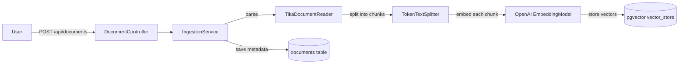
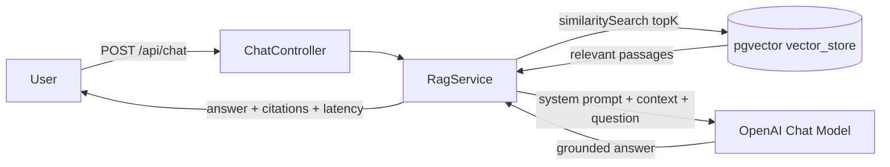

# SupportLens — AI-Powered Support Knowledge Assistant

> Ask a question in plain English; get an answer grounded in **your** documentation, with citations back to the source passages.

SupportLens is a **Retrieval-Augmented Generation (RAG)** service. You upload technical
docs (troubleshooting guides, FAQs, runbooks); it chunks and embeds them into a
**pgvector** store. When a user asks a question, it retrieves the most relevant passages
and hands them to an **LLM** to compose a **source-cited** answer. If the docs don't
cover the question, it says so instead of guessing.

**Example**

> **Q:** "An order is stuck in Processing — what should I check?"
> **A:** "Confirm the payment shows _Authorized_, check the fulfillment queue for the
> order id, and re-publish the order event from the Admin console… _(source: order-troubleshooting.md)_"

---

## Why this project (the 30-second pitch)

- **One clear idea:** _documents → chunks → embeddings → vector search → relevant context → LLM answer with citations._
- **Real AI keywords, honestly earned:** Generative AI, LLMs, RAG, embeddings, vector/semantic search, prompt engineering, evaluation.
- **An engineering story, not just a chatbot:** you can talk about ingestion, retrieval quality, grounding/guardrails, latency, and token cost.
- **Right-sized:** no model training, no autonomous agents, no distributed complexity — small enough to understand end to end.

---

## Architecture

**Ingestion pipeline** (build the knowledge base):



**Query pipeline** (answer a question):



---

## Tech stack

| Concern            | Choice                                                          |
| ------------------ | --------------------------------------------------------------- |
| Language / runtime | Java 21                                                         |
| Framework          | Spring Boot 3.4.x                                               |
| AI orchestration   | Spring AI 1.0.x (`ChatClient`, `EmbeddingModel`, `VectorStore`) |
| Model provider     | OpenAI (swappable to Azure OpenAI)                              |
| Vector store       | PostgreSQL + pgvector                                           |
| Metadata store     | PostgreSQL (JPA + Flyway)                                       |
| Doc parsing        | Apache Tika (via `spring-ai-tika-document-reader`)              |
| API docs           | springdoc / Swagger UI                                          |
| Frontend (Phase 6) | Angular                                                         |
| Infra              | Docker Compose                                                  |

> **Version note:** Spring AI 2.0 exists but requires Spring Boot 4. We deliberately
> use Spring AI **1.0.x + Boot 3.4.x** for stability and the widest set of examples.
> The starter artifact names (`spring-ai-starter-model-openai`,
> `spring-ai-starter-vector-store-pgvector`) are the same in both lines.

---

## How it wires together

Every request flows **Controller → Service (interface) → implementation**, with a
`@RestControllerAdvice` turning errors into clean `ProblemDetail` responses.

- `web/DocumentController` → `ingestion/IngestionService` — upload & list docs.
- `web/ChatController` → `rag/RagService` — ask a question, get a cited answer.
- `config/RagProperties` — binds `supportlens.rag.*` (top-K, similarity threshold, system prompt) so retrieval is tunable without recompiling.
- `common/GlobalExceptionHandler` — consistent error bodies (Phase-stubbed features return **501 Not Implemented**).
- Spring AI auto-configures `EmbeddingModel`, `ChatModel`/`ChatClient.Builder`, and a pgvector `VectorStore` from `application.yml`.

In **Phase 0** the two feature services are wired but throw `UnsupportedOperationException`
(surfaced as 501). Each later phase replaces a stub with a real implementation — so the
app always compiles and runs, and progress is visible at `GET /api`.

---

## Project structure

```
SupportLens/
├── pom.xml                     # Spring Boot 3.4 + Spring AI 1.0 dependencies
├── docker-compose.yml          # Postgres + pgvector (the only infra needed)
├── .env.example                # OPENAI_API_KEY goes here (copy to .env)
├── sample-docs/                # synthetic docs to test ingestion/chat
│   └── order-troubleshooting.md
└── src/
    ├── main/
    │   ├── java/com/supportlens/
    │   │   ├── SupportLensApplication.java     # entry point
    │   │   ├── config/
    │   │   │   └── RagProperties.java           # tunable RAG settings
    │   │   ├── web/
    │   │   │   ├── DocumentController.java       # POST/GET /api/documents
    │   │   │   ├── ChatController.java           # POST /api/chat
    │   │   │   ├── MetaController.java           # GET /api (status + roadmap)
    │   │   │   └── dto/                          # request/response records
    │   │   ├── ingestion/
    │   │   │   ├── IngestionService.java         # contract (Phase 1 & 2)
    │   │   │   ├── DefaultIngestionService.java  # parse + chunk + persist (Phase 1)
    │   │   │   ├── DocumentEntity.java           # documents table
    │   │   │   ├── ChunkEntity.java              # chunks table
    │   │   │   ├── DocumentRepository.java
    │   │   │   └── ChunkRepository.java
    │   │   ├── rag/
    │   │   │   ├── RagService.java               # contract (Phase 3 & 4)
    │   │   │   └── DefaultRagService.java        # stub → real impl
    │   │   └── common/
    │   │       └── GlobalExceptionHandler.java   # ProblemDetail errors
    │   └── resources/
    │       ├── application.yml                   # all configuration
    │       └── db/migration/
    │           ├── V1__enable_extensions.sql     # pgvector extensions
    │           └── V2__documents_and_chunks.sql  # Phase 1 metadata tables
    └── test/java/com/supportlens/
        ├── SupportLensSmokeTest.java             # offline stub-contract tests
        └── ingestion/
            └── DefaultIngestionServiceTest.java  # Phase 1 unit test
```

---

## Phased roadmap

Each phase is a small, demoable increment. Build them in order.

### Phase 0 — Foundation & infrastructure ✅ (scaffolded)

- **Goal:** the app boots, infra is up, and the API surface exists.
- **Included:** Spring Boot skeleton, Docker Compose (Postgres+pgvector), config,
  Flyway extensions migration, actuator health, controllers wired to stub services,
  global exception handling, Swagger UI.
- **Done when:** `docker compose up -d` + `mvn spring-boot:run` → `GET /actuator/health`
  is `UP`, `GET /api` lists the roadmap, and feature endpoints return **501**.

### Phase 1 — Document ingestion (parse + chunk) ✅

- **Goal:** turn an uploaded file into stored, ordered text chunks.
- **Built:** `DefaultIngestionService` reads the upload with `TikaDocumentReader`,
  splits with `TokenTextSplitter.builder()`, and persists a `documents` row + `chunks`
  (Flyway `V2`) via `DocumentEntity`/`ChunkEntity` + repositories.
- **Key APIs:** `TikaDocumentReader`, `TokenTextSplitter`, JPA `@Entity` + repository.
- **Try it:** `curl -F "file=@sample-docs/order-troubleshooting.md" http://localhost:8080/api/documents`
  returns a chunk count; `GET /api/documents` lists it. _(No API key needed yet.)_

### Phase 2 — Embeddings & vector storage

- **Goal:** make chunks semantically searchable.
- **Build:** convert chunks to Spring AI `Document`s (carry `source`/`documentId`
  metadata) and call `vectorStore.add(documents)` — Spring AI embeds them via the
  `EmbeddingModel` and writes vectors to pgvector.
- **Key APIs:** `EmbeddingModel`, `VectorStore.add(...)`, `Document` metadata.
- **Done when:** after upload, rows exist in `vector_store`. _(Needs `OPENAI_API_KEY`.)_

### Phase 3 — Retrieval & RAG answering

- **Goal:** answer a question from the docs, with citations.
- **Build:** in `DefaultRagService`, `vectorStore.similaritySearch(SearchRequest…topK)`,
  assemble the system prompt + retrieved context, call the LLM via `ChatClient`, and map
  the passages into `Citation`s.
- **Key APIs:** `VectorStore.similaritySearch`, `SearchRequest`, `ChatClient`.
- **Done when:** `POST /api/chat` returns a relevant answer plus citations and `latencyMs`.

### Phase 4 — Guardrails & graceful fallback

- **Goal:** don't answer what the docs can't support.
- **Build:** apply `similarityThreshold`; if no passage qualifies, return
  `grounded=false` with a "not enough information" message. Validate inputs.
- **Done when:** an off-topic question returns a polite fallback, not a hallucination.

### Phase 5 — Evaluation harness

- **Goal:** measure quality instead of eyeballing it.
- **Build:** a small curated Q&A set (including unanswerable questions); a runner that
  reports retrieval hit-rate and answer correctness, and logs latency + token usage.
- **Done when:** an `eval` run prints a metrics summary you can screenshot for the README.

### Phase 6 — Angular chat UI

- **Goal:** a browsable demo.
- **Build:** an upload screen and a chat screen that renders answers + clickable citations.
- **Done when:** you can demo the whole flow in a browser.

### Phase 7 — Containerize & polish

- **Goal:** one-command run and a tidy repo.
- **Build:** a `Dockerfile` for the app, extend Compose to run it, add a
  `@SpringBootTest` + Testcontainers smoke test, finalize docs and a demo GIF.
- **Done when:** `docker compose up` brings up the full stack.

---

## Getting started

**Prerequisites:** JDK 21, Maven (or your IDE's Java tooling), Docker.

1. **Start the database**
   ```bash
   docker compose up -d
   ```
2. **Set your API key** (needed from Phase 2 onward; Phase 0–1 run without it)
   ```powershell
   $env:OPENAI_API_KEY = "sk-your-real-key"   # PowerShell
   ```
   ```bash
   export OPENAI_API_KEY="sk-your-real-key"    # bash/zsh
   ```
3. **Run the app**
   ```bash
   mvn spring-boot:run
   ```
4. **Try it**
   - Roadmap/status: <http://localhost:8080/api>
   - Health: <http://localhost:8080/actuator/health>
   - Swagger UI: <http://localhost:8080/swagger-ui.html>

Until the relevant phase is built, `/api/documents` and `/api/chat` return **501 Not Implemented** by design.

---

## API reference

| Method | Path               | Purpose                       | Available |
| ------ | ------------------ | ----------------------------- | --------- |
| GET    | `/api`             | Service info + phase roadmap  | Phase 0   |
| GET    | `/actuator/health` | Liveness/readiness            | Phase 0   |
| POST   | `/api/documents`   | Upload a document (multipart) | Phase 1   |
| GET    | `/api/documents`   | List ingested documents       | Phase 1   |
| POST   | `/api/chat`        | Ask a question → cited answer | Phase 3   |

---

## Configuration (`application.yml`)

| Key                                         | Default                  | Meaning                                  |
| ------------------------------------------- | ------------------------ | ---------------------------------------- |
| `spring.ai.openai.api-key`                  | placeholder              | API key (override via `OPENAI_API_KEY`)  |
| `spring.ai.openai.chat.options.model`       | `gpt-4o-mini`            | Chat model                               |
| `spring.ai.openai.embedding.options.model`  | `text-embedding-3-small` | Embedding model (1536 dims)              |
| `spring.ai.vectorstore.pgvector.dimensions` | `1536`                   | Must match the embedding model           |
| `supportlens.rag.top-k`                     | `4`                      | Passages retrieved per question          |
| `supportlens.rag.similarity-threshold`      | `0.5`                    | Min relevance to use a passage (Phase 4) |
| `supportlens.rag.system-prompt`             | see file                 | How the LLM should answer and cite       |

---

## Data & honesty notes

- Use **synthetic or public** documentation only — never confidential/employer data.
- Keep resume/README claims to what you actually build. Avoid unmeasured claims like
  "eliminated hallucinations" or invented accuracy numbers. Phase 5 gives you _real_
  numbers to cite.

---

## Resume bullet (once built)

> **SupportLens — AI-Powered Support Knowledge Assistant** · _Java, Spring Boot, Spring AI, PostgreSQL/pgvector, Angular, Docker_
> Built a Retrieval-Augmented Generation (RAG) service answering support questions from
> technical docs using LLMs, embeddings, and vector similarity search; added source-cited
> answers, a no-answer fallback, and an evaluation harness tracking retrieval relevance,
> latency, and token usage.

## Interview cheat-sheet

- **What is it?** A RAG service that answers from your docs with citations.
- **How does retrieval work?** Chunks are embedded into vectors; a question is embedded
  and compared by cosine similarity in pgvector; the top-K passages become the LLM's context.
- **Why not just ask the LLM?** Grounding in retrieved passages keeps answers accurate,
  current, and cite-able — and lets it say "I don't know."
- **How do you know it's good?** The Phase 5 eval set measures retrieval hit-rate and
  answer correctness, plus latency and token cost.
- **What would you improve next?** Re-ranking, hybrid keyword+vector search, streaming
  responses, and per-tenant document isolation.
